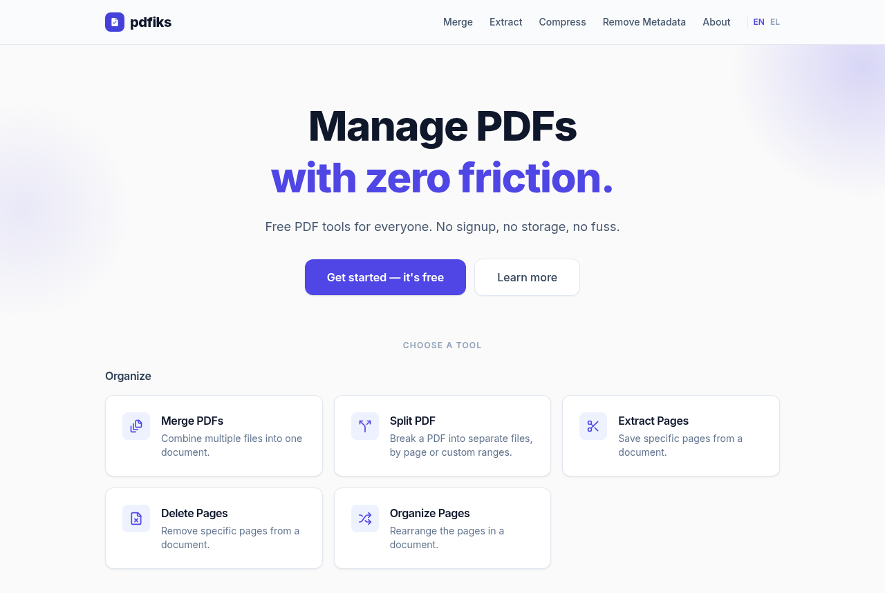

# Pdfiks

**Free PDF tools with zero friction.** No sign-up, no storage, no fuss.

Pdfiks covers the everyday PDF jobs: merge, split, extract, delete and reorder pages, rotate, compress, watermark, add page numbers, add or remove a password, strip metadata, and convert to and from images. It also includes the **PDF Threat Shield**, which scans a file for hidden active content. Uploaded files are deleted automatically. It's available in English and Greek.

**Live at [pdfiks.com](https://pdfiks.com)**

> The application source is private. This repository describes what Pdfiks does and how it's built, and it will host parts of it released as open source.

  
  

## How it works

Every one of the 15 tools has the same shape. A controller validates the upload and its options, a background job does the work, and the page updates live over a WebSocket the moment the result is ready. One registry of tools drives the home page, navigation, sitemap and related-tool links, so adding a tool is a single entry plus its page.

The actual PDF work is never done by a PDF-parsing library inside the app. Each job calls a well-known, battle-tested command-line tool:

| Tool | Used for |
|---|---|
| **pdftk** | Merge, split, extract, delete, reorder and rotate pages; stamping watermarks and page numbers |
| **Ghostscript** | Compression profiles, and rewriting a file to collapse its metadata history |
| **qpdf** | Adding and removing passwords; normalising a file for inspection |
| **exiftool** | Stripping EXIF, XMP, IPTC and document metadata |
| **pdftoppm** | Rendering pages to images |

The only new content Pdfiks draws itself (watermark text, page-number stamps, pages built from photos) is generated with Prawn, a pure-Ruby PDF writer, and then stamped onto the real document by pdftk. Decoding the untrusted bytes of an upload only ever happens inside the sandboxed CLI tools.

## Handling untrusted files

Every upload is treated as hostile.

- **No shell interpolation, ever.** Every subprocess receives its arguments as an array, never as a command string. CI fails the build if the interpolated form appears anywhere.
- **No user-controlled paths.** Files handed to a CLI tool always have server-generated names, which keeps the class of filename-based Ghostscript and pdftk vulnerabilities out of reach.
- **Ghostscript always runs with `-dSAFER`** passed explicitly, never relying on a version's default. A test asserts this for every Ghostscript-based tool.
- **Every process is boxed in** by a wall-clock timeout, a CPU-time limit and a memory cap.
- **Abuse protection** with rate limiting and Cloudflare Turnstile, a privacy-friendly bot check that needs no tracking cookies.

## PDF Threat Shield

The scanner first normalises the file with qpdf, which expands compressed object streams so nothing can hide inside one. It then looks for object types that carry active or dangerous content: JavaScript, auto-run actions, launch commands, embedded files, rich media and forms. It reports what it found, in plain language, without changing the file.

To clean a flagged file, Pdfiks renders every page to an image and builds a brand-new PDF from those images. Nothing structural from the original survives, by construction rather than by editing the file in place.

## Privacy

Uploads and results are deleted automatically shortly after they're created: long enough to download the result, not long enough for anything to accumulate. A second, independent cleanup job backs up that promise. You never need an account.

## Stack

Ruby 3.4 · Rails 8.1 · SQLite · Solid Queue, Solid Cache and Solid Cable · Hotwire (Turbo + Stimulus) · Tailwind CSS · pdftk, Ghostscript, qpdf, exiftool, poppler · Prawn · Minitest and system tests · Kamal.

## History

Launched in March 2025 with four tools (merge, extract, compress, remove metadata). Since then: reliability and security hardening, eleven more tools, and the Threat Shield in July 2026.
